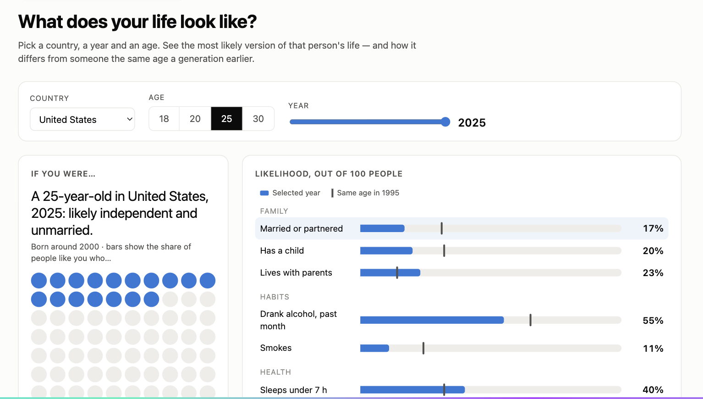

# Daniela Avayu

## Description

Lately, I’ve been really interested in the idea that young people are changing significantly compared with previous generations. I’m particularly interested in exploring the intersection between health and lifestyle trends, such as drug consumption, sleep patterns, physical fitness, and general habits, as well as changes in religion, high cost of life, fertility, and family formation.

I want to explore how significant these trends actually are, how widespread they are across different cultures and countries, and whether they represent broader generational changes or are specific to certain contexts. I’m also interested in conducting some form of cohort analysis, comparing groups of people born in different periods to better understand how behaviors and attitudes have changed over time and what factors might be driving these changes.

Things I have read/listened to:
1. https://open.spotify.com/episode/3911bUMgN0P9W5WEoUAM5v
2. https://www.parents.com/why-teens-are-socializing-less-12024663
3. https://www.cnbc.com/make-it/2024/08/16 why-more-americans-dont-want-kids.html
4. https://steffanpiper.medium.com the-vanishing-teenage-social-life-or-just-a-different-one-9783ce19aede
5. https://www.npr.org/2026/10/24/nx-s1-6012804/birth-rate-population-cdc

## Technical Plan re: Option A/B/C/D

I plan to pursue Option A: Large Interactive. The centerpiece will be an interactive visualization showing how selected aspects of young adults’ lives in Chile vary by age and survey year. Users will choose an age (18, 20, 25, or 30), a survey year, and an indicator. If the data support it, they will also be able to select a region within Chile. The main chart will update to show the estimated share of people in that group with the selected characteristic and compare it with people of the same age in another survey year. Supporting text and smaller charts will provide context.

What I imagine is to find like three prototypes of 18, 20, 25, 30 year old in different countries, so say like: choose the year and choose the country and this is how your life will likely look like and be able to show like likelihood of being married, being a parent, drinking alcohol, smoking, etc. 

## Mockup

Inspiration:
https://1in8b.life/en/

I want to do. something like this but more than demographics variables, I want to show how your life/habits would potentially look like. I did a mockup using Claude to show how I imagine this idea looking. 

[Open the interactive HTML mockup](mockup/mockup.html)

## Data Sources
My idea is to initially start with Chile which I know has the data I am looking for. I have not finished exploring it because they are very big surveys but I have worked with both of them before and know that they have the variables I am looking for. 

### Data Source 1: CASEN

URL: https://observatorio.ministeriodesarrollosocial.gob.cl/encuesta-casen

Size: {Number of Rows} rows, {Number of Columns} columns

The Encuesta de Caracterización Socioeconómica Nacional (CASEN) is a major national household survey in Chile used to measure poverty, income distribution, and living conditions.

### Data Source 2: INE

URL: https://observatorio.ministeriodesarrollosocial.gob.cl/encuesta-casen

Size: {Number of Rows} rows, {Number of Columns} columns

The Instituto Nacional de Estadísticas (INE) is the state-run national statistical service of the Government of Chile.

## Questions

{Numbered list of questions for course staff, if any.}

1. Does it seem like too much? Should I maybe limit the variables/countries? Maybe it would make sense to just do it by regions in Chile and after that think about expanding to other countries since I think the data I want is very local (except for things like fertility rates or income)
2. Do you think this is interesting?
3. How else could I visualize this idea?